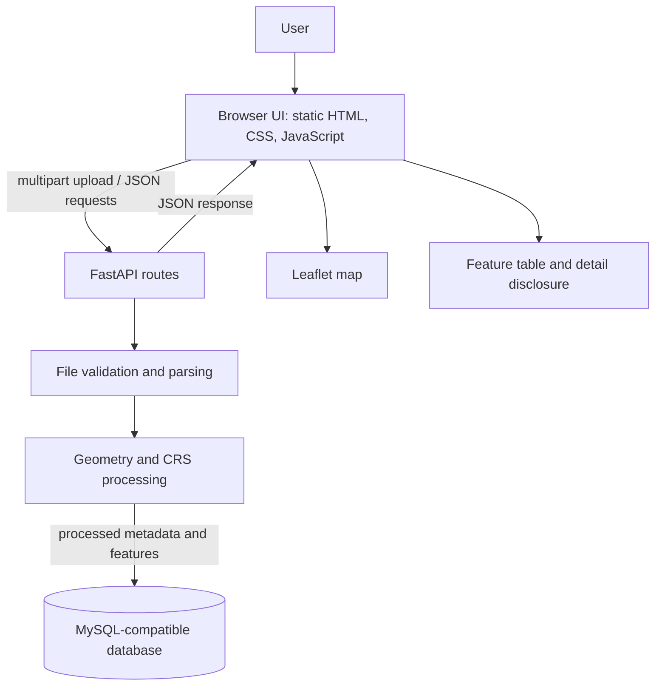

# GeoMeasure - Geospatial File Measurement API

GeoMeasure is a small geospatial processing application. It accepts KML files and ZIP archives containing a Shapefile, extracts their features and properties, calculates polygon areas or line lengths when possible, and presents the results in a browser interface with an interactive map and feature table.

The project addresses the effort and errors involved in manually measuring many geographic features. Its FastAPI backend parses and processes uploads, stores processed metadata and feature results in a configured MySQL-compatible database, and serves both the browser UI and JSON API. Uploaded source files are processed from temporary storage and are not retained.

## Features

- Accepts `.kml` uploads and `.zip` archives containing exactly one Shapefile.
- Supports Point, MultiPoint, LineString, MultiLineString, Polygon, and MultiPolygon geometries when represented by the parser and measurement service.
- Preserves feature properties from KML names, descriptions, and ExtendedData, and from Shapefile records.
- Calculates polygon and multipolygon areas in a projected coordinate system and line and multiline lengths in meters.
- Uses KML's EPSG:4326 coordinates or a Shapefile `.prj` file to determine the source coordinate reference system (CRS).
- Returns original geometry, map-ready WGS 84 geometry, measurement and CRS metadata, and per-feature processing errors.
- Shows uploaded geometries on a Leaflet map and synchronizes map and table selection.
- Stores processed metadata and feature measurements in MySQL-compatible storage configured through environment variables.
- Limits uploads to 50 MiB and applies ZIP member-count, expanded-size, and extraction-path checks.

The current interface does not include charts, feature search, filtering, geometry repair, or data export.

## Problem and objectives

Geographic datasets can contain many points, routes, and boundaries. Manually inspecting each feature and calculating its size or length takes time and can produce inconsistent results. GeoMeasure automates parsing and per-feature measurement for two common exchange formats, then presents the output in both a map and a structured table.

The API returns dataset metadata and a feature list. Each feature includes its properties and geometry, CRS information, a nullable measurement and unit, and any processing or map-conversion error. Points are retained and mapped where possible but do not receive an area or length measurement.

CRS handling is central to measurement: longitude and latitude in EPSG:4326 are angular degrees, not linear meters. GeoMeasure projects each measurable feature to a UTM CRS selected from a representative point before calculating planar area or length. This is a practical local projection strategy, with limits for features that span large regions or cross UTM zones.

## Architecture



- **Browser UI:** `server/app/static/index.html` provides the upload form, status messages, results summary, Leaflet map, feature table, and feature detail disclosure. It calls the API with browser `fetch` and is served at `/` by FastAPI.
- **API:** `server/app/main.py` creates the FastAPI app, serves the UI, and exposes the database health endpoint. `server/app/routes/files.py` implements file upload and retrieval endpoints.
- **Processing:** `server/app/services/file_service.py` validates uploads, safely extracts Shapefile archives, and parses KML or Shapefile content. `server/app/services/measurement_service.py` converts geometry for display and calculates measurements.
- **Persistence:** `server/app/services/storage_service.py` writes and reads processed records. `server/app/utils/database.py` configures the PyMySQL connection and creates the `files` and `features` tables when a database operation initializes storage.
- **Schemas:** `server/app/schemas/file.py` defines the response models used for API validation and serialization.

## Technology stack

| Technology | Role |
|---|---|
| Python 3.10 or later | Backend language; the source uses modern union type syntax. |
| FastAPI, Uvicorn | HTTP API, request validation, API docs, and local ASGI server. |
| Shapely | Geometry construction, transformations, validity checks, and planar area/length operations. |
| pyproj | CRS parsing, coordinate transformations, and UTM CRS selection. |
| pyshp | Shapefile and attribute-record reading. |
| Python XML, ZIP, and temporary-file libraries | KML parsing, archive inspection/extraction, and temporary upload workspaces. |
| PyMySQL, certifi | TLS-enabled database connections to the configured MySQL-compatible service. |
| HTML, CSS, JavaScript | Browser interface; there is no separate frontend build step. |
| Leaflet 1.9.4 | Browser map, loaded from unpkg CDN. |

Python dependencies are listed in `server/requirements.txt`. They are not version-pinned. The processing code calls the Shapely 2 transformation API; use a Shapely 2 compatible environment. There is no Node.js package manifest or charting library.

## Project structure

```text
GeoMeasure/
|-- .gitignore
|-- README.md
`-- server/
    |-- requirements.txt
    |-- vercel.json
    `-- app/
        |-- main.py
        |-- routes/
        |   `-- files.py
        |-- schemas/
        |   `-- file.py
        |-- services/
        |   |-- file_service.py
        |   |-- measurement_service.py
        |   `-- storage_service.py
        |-- static/
        |   `-- index.html
        `-- utils/
            `-- database.py
```

The repository has no separate frontend source/build directory or sample-data directory.

## Requirements and setup

### Prerequisites

- Python 3.10 or later.
- Internet access in the browser for Leaflet assets and OpenStreetMap tiles.

Node.js is not required. The repository does not pin Python or package versions. The code uses the Shapely 2 API.

### Windows PowerShell

From the repository root:

```powershell
cd server
python -m venv .venv
.\.venv\Scripts\Activate.ps1
python -m pip install --upgrade pip
python -m pip install -r requirements.txt
```

Start the backend from the `server` directory:

```powershell
python -m uvicorn app.main:app --reload
```

Open:

- Web interface: <http://127.0.0.1:8000/>
- Interactive API documentation: <http://127.0.0.1:8000/docs>
- OpenAPI schema: <http://127.0.0.1:8000/openapi.json>

### Linux and macOS

```bash
cd server
python3 -m venv .venv
source .venv/bin/activate
python -m pip install --upgrade pip
python -m pip install -r requirements.txt
```

```bash
python -m uvicorn app.main:app --reload
```

### Vercel deployment

`server/vercel.json` includes `app/static/**` with the `app/main.py` function. Configure the Vercel project root directory as `server`.

## API reference

The API uses JSON responses except for the multipart upload request. FastAPI validation and application errors use the standard `{"detail": ...}` response shape.

| Method and path | Purpose | Success | Common errors |
|---|---|---|---|
| `GET /api/health` | Connects to and initializes the database tables. | `200` with `{"status":"ok"}` | `503` if database configuration, connection, or initialization fails. |
| `POST /api/files/` | Parses and measures a KML or zipped Shapefile, saves its results, and returns the dataset and features. | `201` with an `UploadResponse`. | `400` for unsupported/invalid/empty/oversized input; `422` when the required `file` field is absent; `503` when storing results fails. |
| `GET /api/files/{file_id}/` | Returns stored file metadata. | `200` with a `FileResponse`. | `404` if the ID is unknown; `503` on database errors. |
| `GET /api/files/{file_id}/measurements/` | Returns stored per-feature results. | `200` with a `MeasurementsResponse`. | `404` if the ID is unknown; `503` on database errors. |
| `GET /api/files/{file_id}/export.csv` | Downloads feature IDs, source coordinates and CRS, properties, and measurements as CSV. | `200` with a downloadable CSV file. | `404` if the ID is unknown; `503` on database errors. |
| `GET /api/files/{file_id}/export.geojson` | Downloads mapped features and measurement metadata as a GeoJSON FeatureCollection. | `200` with a downloadable GeoJSON file. | `404` if the ID is unknown; `503` on database errors. |

The dashboard exposes both downloads after a dataset is processed. CSV coordinates use the source CRS. GeoJSON geometry uses WGS 84 coordinates when conversion is available; source CRS, projected CRS, original properties, and measurements are included as feature properties. If map conversion is unavailable, the GeoJSON geometry is `null` and the original geometry is included as `source_geometry`.

### `POST /api/files/`

- Content type: `multipart/form-data`.
- Required field: `file`.
- Accepted filename extensions: `.kml` and `.zip` (case-insensitive).
- Maximum upload size: 50 MiB.
- A ZIP must contain exactly one `.shp` file and matching `.shx` and `.dbf` files in the same directory. A `.prj` file is optional.

```bash
curl -X POST http://127.0.0.1:8000/api/files/ \
  -F "file=@survey.kml"
```

The following example shows the response structure. Values are illustrative; IDs are generated per upload. Feature fields with no value are returned as `null`.

```json
{
  "id": "<generated-uuid>",
  "filename": "survey.kml",
  "feature_count": 1,
  "crs": "EPSG:4326",
  "status": "COMPLETED",
  "features": [
    {
      "index": 0,
      "geometry_type": "Polygon",
      "geometry": {
        "type": "Polygon",
        "coordinates": [[[72.0, 19.0], [72.01, 19.0], [72.01, 19.01], [72.0, 19.0]]]
      },
      "map_geometry": {
        "type": "Polygon",
        "coordinates": [[[72.0, 19.0], [72.01, 19.0], [72.01, 19.01], [72.0, 19.0]]]
      },
      "map_error": null,
      "properties": {"Name": "Example plot"},
      "source_crs": "EPSG:4326",
      "projected_crs": "EPSG:32643",
      "measurement": 123456.7,
      "unit": "m^2",
      "processing_error": null
    }
  ]
}
```

The current source contains a character-encoding artifact in the area unit literal, so the API may not emit the intended square-meter label correctly. The value above uses `m^2` to express the intended unit. See [limitations](#limitations-and-possible-improvements).

### `GET /api/files/{file_id}/`

Returns the stored dataset metadata:

```json
{
  "id": "<generated-uuid>",
  "filename": "survey.kml",
  "feature_count": 1,
  "crs": "EPSG:4326",
  "status": "COMPLETED"
}
```

Example:

```bash
curl http://127.0.0.1:8000/api/files/00000000-0000-4000-8000-000000000000/
```

### `GET /api/files/{file_id}/measurements/`

Returns the feature list stored for the dataset. Each feature has the same shape as an item in the upload response.

```json
{
  "file_id": "<generated-uuid>",
  "features": []
}
```

Example:

```bash
curl http://127.0.0.1:8000/api/files/00000000-0000-4000-8000-000000000000/measurements/
```

## Geospatial processing

### Processing flow

1. FastAPI validates the filename extension and reads at most 50 MiB plus one byte to detect oversized uploads.
2. The file service rejects empty content. KML data is written to a temporary directory. ZIP data is extracted there only after archive member count, declared and actual expanded size, path traversal, duplicate path, and symbolic-link checks.
3. KML is parsed as XML. The parser walks `Placemark` elements throughout the document, including nested `Document` and `Folder` containers, and reads supported geometry children and basic properties. It does not implement every KML construct.
4. Shapefile records and DBF properties are read with pyshp. `.shp`, `.shx`, and `.dbf` components are required; a sibling `.prj` file supplies the CRS when present.
5. KML is assigned EPSG:4326. For a Shapefile without `.prj`, the source CRS is unknown.
6. Valid, non-empty features with a known CRS are transformed to EPSG:4326 for the map. They are separately projected for measurement as described below.
7. Feature results are validated against Pydantic response schemas and saved to the database. The API returns the metadata and complete feature list. Temporary upload files are removed when processing exits.

### Geometry and measurement behavior

| Geometry | Measurement | Unit | Notes |
|---|---|---|---|
| Point, MultiPoint | None | N/A | Preserved and mapped if possible; no area or length is assigned. |
| LineString, MultiLineString | Planar length | Meters (`m`) | Projected into a selected UTM CRS first. |
| Polygon, MultiPolygon | Planar area | Square meters (`m^2`) | Projected into a selected UTM CRS first. |
| Other types, including mixed-geometry `GeometryCollection` | None | N/A | Returned with a per-feature unsupported-geometry error when parsed. |

The measurement service transforms each feature to EPSG:4326, takes a representative point, determines its UTM zone, and chooses the northern or southern UTM EPSG code from the point's latitude. It then transforms that feature from its source CRS to the selected UTM CRS and uses Shapely's planar `.area` or `.length` operation. Coordinates are transformed with `always_xy=True` so longitude/easting is treated as the x-axis.

This strategy assumes a feature is reasonably represented by one local UTM zone. The code accepts longitude from -180 degrees through 180 degrees and latitude from -80 through 84 degrees; features outside this range cannot be measured. Large, global, or cross-zone features can have distortion or an unsuitable single-zone result. The application does not currently choose equal-area projections or calculate geodesic measurements.

## Design decisions and trade-offs

- **FastAPI:** provides typed request handling, response models, and generated OpenAPI documentation with a small route layer.
- **Shapely and pyproj:** separate geometry operations from CRS transformation and measurement, while allowing each feature's errors to be recorded alongside results.
- **KML and zipped Shapefile:** cover two common exchange formats. ZIP extraction uses a temporary directory and explicit safety limits; uploads are not retained as source files.
- **Per-feature UTM:** gives local planar meter units for common regional data and avoids applying planar measurement directly to angular longitude/latitude coordinates. It is not a universal projection strategy.
- **Database persistence:** `files` stores upload metadata and `features` stores geometry, properties, CRS, measurements, and processing errors. Tables are initialized lazily by database operations.
- **Synchronous processing:** parsing and measurement happen in the upload request. This keeps the implementation straightforward, but long or complex jobs occupy request processing time; there is no task queue or progress reporting.
- **Static frontend:** avoids a separate build system, but Leaflet and map tiles depend on external services being available in the browser.

## Errors and edge cases

| Input or condition | Current behavior |
|---|---|
| Unsupported extension, empty file, or upload over 50 MiB | Upload endpoint returns `400` with a detail message. |
| Malformed KML XML, invalid KML root, unreadable ZIP, invalid Shapefile, missing required Shapefile component, or no extracted features | Processing raises an error and upload returns `400`. |
| ZIP has no `.shp`, more than one `.shp`, unsafe/duplicate paths, a symbolic link, over 2,000 members, or expands beyond 200 MiB | ZIP is rejected and upload returns `400`. |
| Shapefile has no `.prj` | Features are returned with unknown source CRS. Map conversion is unavailable and measurable feature types receive a processing error for missing CRS. |
| Null or empty geometry | Feature is preserved with a processing error and no measurement. A Shapefile with records but null shapes can still return feature results. |
| Invalid geometry | Feature is preserved with an invalid-geometry error and no measurement. The service does not repair it. |
| Unsupported geometry type | Feature is preserved with an unsupported-type error and no measurement. |
| Feature outside the supported UTM latitude range or a transformation failure | Measurement error is stored on that feature; other features can still be processed. |
| KML with no supported, parseable features | Upload returns `400` because the dataset has no features. |
| KML with a supported Placemark geometry but malformed coordinates | Parsing fails for the upload; the whole request returns `400`. |
| Missing file form field | FastAPI returns `422` validation error. |
| Database unavailable or table/data operation fails | Database health and file endpoints return `503`; upload processing is not considered successful if results cannot be saved. |
| Unknown file ID on either retrieval endpoint | Returns `404` with `{"detail":"File not found"}`. |

KML parsing supports Point, LineString, Polygon, and MultiGeometry composed of one geometry type. A mixed MultiGeometry becomes a GeometryCollection and is not measurable by the current service. The parser traverses nested folders/documents by searching all descendants for placemarks, but does not cover all KML features such as NetworkLinks or every ExtendedData representation.

## Using the web interface

1. Open <http://127.0.0.1:8000/> after configuring the database and starting FastAPI.
2. Choose or drop a `.kml` file or a `.zip` containing one Shapefile (maximum 50 MiB).
3. Select **Process file** and wait for the request to finish. Success, validation, and server errors appear in the status area.
4. Review the dataset summary and map preview.
5. Select a map feature or table row to highlight and zoom to that feature.
6. Expand the selected feature's detail disclosure to inspect its properties, geometry, CRS, measurement, and processing information.

The UI does not provide filtering, searching, charts, editing, or export. Upload and retrieval endpoints persist processed results through the configured database.

## Sample data

No sample geographic datasets are checked into this repository. Prepare a KML file or a ZIP containing the `.shp`, `.shx`, and `.dbf` files for one Shapefile; include a matching `.prj` when its source CRS is known. Do not use a dataset with sensitive location or attribute data in a public environment.

## Limitations and possible improvements

- Pin and document dependency versions.
- Improve projection selection for large, global, or cross-zone features; consider geodesic length and equal-area calculations where appropriate.
- Add streaming uploads, background processing, request limits at deployment, and progress reporting for larger workloads.
- Expand KML support for more complex and mixed geometry structures, and define whether geometry repair should be supported.
- Add optional result export and table filtering when those workflows are needed.
- Correct the area-unit string's source encoding so the API emits `m^2` consistently. The measurement itself is stored as a numeric area in square meters.

## Learning outcomes

The code demonstrates REST API design, multipart upload handling, geospatial format parsing, CRS transformation, geometry measurement, relational persistence, frontend/backend integration, and per-feature error reporting.

## Author and license

No author information or license file is present in the repository. No license has been specified.
