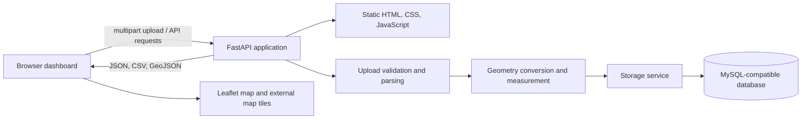

# Arero_QGIS: Geospatial File Measurement

Arero_QGIS is a geospatial file processing application that accepts KML files and ZIP archives containing one Shapefile. It parses feature geometries and attributes, calculates local projected areas or lengths where supported, stores processed results in a MySQL-compatible database, and provides an interactive map and feature dashboard.

The application is intended for GIS analysts, survey teams, planners, and developers who need to review and measure features from exchange datasets without manually calculating each polygon or route.

## Contents

- [Overview](#overview)
- [Implemented Features](#implemented-features)
- [Technology Stack](#technology-stack)
- [Architecture](#architecture)
- [Project Structure](#project-structure)
- [Prerequisites](#prerequisites)
- [Installation and Run](#installation-and-run)
- [Configuration](#configuration)
- [Swagger and OpenAPI](#swagger-and-openapi)
- [Supported Geospatial Formats](#supported-geospatial-formats)
- [API Reference](#api-reference)
- [Usage Guide](#usage-guide)
- [Validation and Limitations](#validation-and-limitations)
- [Testing](#testing)
- [Security Notes](#security-notes)
- [Future Work](#future-work)
- [License and Contributions](#license-and-contributions)

## Overview

Geographic datasets often contain many boundaries, routes, and other features. Inspecting each feature and calculating its area or length manually is time-consuming and can lead to inconsistent results. Arero_QGIS automates supported file parsing, per-feature measurements, result persistence, map display, and export.

Each processed feature has an index, geometry type, source geometry, optional map-ready geometry, attributes, source and projected CRS metadata, a nullable measurement and unit, and processing/conversion errors when applicable. The browser dashboard summarizes measurable area and length totals, supports feature inspection, and downloads CSV or GeoJSON results.

## Implemented Features

- Upload a `.kml` file or a `.zip` containing exactly one Shapefile, with a maximum uploaded size of 50 MiB.
- Parse KML Point, LineString, Polygon, and homogeneous MultiGeometry features. Read Placemark names, descriptions, and supported ExtendedData fields.
- Read Shapefile feature geometry and DBF attributes; use a matching `.prj` file for the source CRS when present.
- Map supported Point, MultiPoint, LineString, MultiLineString, Polygon, and MultiPolygon geometries when CRS conversion succeeds.
- Calculate polygon and multipolygon area in square metres and line and multiline length in metres by projecting each feature into a selected UTM CRS. Points are mapped when possible but are not measured.
- Store file metadata and processed features in MySQL-compatible storage. The source upload is processed in a temporary directory and is not retained as an uploaded file.
- View aggregate area and length totals, feature attributes, CRS details, processing errors, and feature geometries in the dashboard.
- Search feature names, geometry types, and attribute values; filter by geometry type; sort by index, name, geometry type, or measurement.
- Change displayed area and length units, switch between street and satellite basemaps, toggle light/dark themes, fit the map to visible features, and select features from either the table or map.
- Export persisted feature results to CSV or GeoJSON. CSV coordinates are in the source geometry CRS; GeoJSON uses WGS 84 map geometry when available.
- Validate upload extension, size, empty content, Shapefile component files, and ZIP archive member paths, count, and expanded size.

The browser displays the selected file size before upload. File size is not part of the stored file record or API response.

## Technology Stack

| Component | Technologies in the repository |
|---|---|
| Backend | Python 3.10 or later, FastAPI, Uvicorn |
| Geometry and CRS | Shapely 2-compatible APIs, pyproj, pyshp (`shapefile`) |
| Database | MySQL-compatible database via PyMySQL; TLS uses the certifi CA bundle |
| Frontend | Static HTML, CSS, and JavaScript served by FastAPI; no separate build step |
| Map | Leaflet 1.9.4, OpenStreetMap street tiles, and Esri World Imagery tiles, loaded externally by the browser |
| Supporting libraries | python-multipart, python-dotenv, httpx, pytest, certifi |
| Python standard library | XML parsing, ZIP processing, temporary files, CSV and JSON serialization |

Python dependencies are declared in `server/requirements.txt` and are not version-pinned. There is no Node.js package manifest or frontend package manager configuration.

## Architecture



`server/app/main.py` serves the static dashboard and health endpoint. `server/app/routes/files.py` implements upload, retrieval, and exports. The file and measurement services validate and process input, while the storage and database modules persist result metadata and features.

## Project Structure

```text
Arero_QGIS/
|-- .gitignore
|-- README.md
`-- server/
    |-- requirements.txt
    |-- vercel.json
    `-- app/
        |-- main.py
        |-- routes/
        |   `-- files.py
        |-- schemas/
        |   `-- file.py
        |-- services/
        |   |-- file_service.py
        |   |-- measurement_service.py
        |   `-- storage_service.py
        |-- static/
        |   `-- index.html
        `-- utils/
            `-- database.py
```

| Path | Purpose |
|---|---|
| `server/app/main.py` | Creates the FastAPI app, serves `/`, and exposes `/api/health`. |
| `server/app/routes/files.py` | Upload, file metadata, measurement, CSV, and GeoJSON routes. |
| `server/app/schemas/file.py` | Pydantic API response schemas. |
| `server/app/services/file_service.py` | Upload validation, safe ZIP extraction, and KML/Shapefile parsing. |
| `server/app/services/measurement_service.py` | Geometry/CRS conversion and per-feature measurement. |
| `server/app/services/storage_service.py` | Persists and retrieves file and feature records. |
| `server/app/utils/database.py` | Loads database settings, opens TLS connections, and initializes tables. |
| `server/app/static/index.html` | Complete browser dashboard; no build output is required. |
| `server/requirements.txt` | Python runtime and development dependencies. |
| `server/vercel.json` | Vercel function configuration, including the static HTML asset. |

There are no checked-in sample datasets, automated test files, `LICENSE` file, or `CONTRIBUTING` guide in the repository at the time of writing.

## Prerequisites

- Python 3.10 or later. Use a Shapely 2-compatible release; the application uses the Shapely 2 transformation API.
- A MySQL-compatible database and network access to it for health checks, uploads, retrieval, and exports.
- Browser internet access for the externally loaded Leaflet library, web fonts, and map tiles.
- Git to clone the repository.

Node.js is not required. A database must already exist: the application creates its `files` and `features` tables, but does not create the database/schema itself.

## Installation and Run

Clone the repository using its Git URL, then enter the project directory:

```bash
git clone <repository-url> Arero_QGIS
cd Arero_QGIS
```

Replace `<repository-url>` with the URL for your copy of the repository.

### Windows PowerShell

From the repository root:

```powershell
cd .\server
py -3.10 -m venv .venv
.\.venv\Scripts\Activate.ps1
python -m pip install --upgrade pip
python -m pip install -r requirements.txt
```

Configure the database variables in `server/.env` as described in [Configuration](#configuration), then start the backend from the `server` directory:

```powershell
python -m uvicorn app.main:app --reload
```

If PowerShell does not allow environment activation, run Uvicorn directly through the virtual environment:

```powershell
.\.venv\Scripts\python.exe -m uvicorn app.main:app --reload
```

### Linux and macOS

From the repository root:

```bash
cd server
python3 -m venv .venv
source .venv/bin/activate
python -m pip install --upgrade pip
python -m pip install -r requirements.txt
```

Configure `server/.env`, then start the backend from the `server` directory:

```bash
python -m uvicorn app.main:app --reload
```

By default, Uvicorn serves the app at `http://127.0.0.1:8000`. Stop the development server with `Ctrl+C`.

The dashboard is served by the same FastAPI process at `/`; there is no separate frontend server or build command.

### Vercel Configuration

`server/vercel.json` configures `app/main.py` as a function and includes `app/static/**`. The Vercel project root should be set to `server`. Database environment variables must also be configured in the deployment environment. The repository does not include additional deployment automation.

## Configuration

Create `server/.env` locally. The root `.gitignore` excludes `.env` and `.env.*`; do not commit credentials. `python-dotenv` loads this file when the database module is imported.

```dotenv
DB_HOST=
DB_PORT=4000
DB_USERNAME=
DB_PASSWORD=
DB_DATABASE=
```

| Variable | Required | Description |
|---|---:|---|
| `DB_HOST` | Yes | Hostname of the MySQL-compatible database. |
| `DB_USERNAME` | Yes | Database user. |
| `DB_PASSWORD` | Yes | Database password. Keep it private and out of version control. |
| `DB_DATABASE` | Yes | Existing database/schema name to connect to. |
| `DB_PORT` | No | Database port; defaults to `4000` if omitted. Must be an integer from 1 through 65535. |

Connections use `utf8mb4`, a 10-second connection timeout, and TLS with the CA bundle supplied by certifi. Configure the database user with permission to connect and create tables, and with the read/write privileges needed by the application. The app lazily creates `files` and `features` tables during database operations.

## Swagger and OpenAPI

FastAPI's built-in interactive API documentation is enabled:

| Documentation | Local URL |
|---|---|
| Swagger UI | <http://127.0.0.1:8000/docs> |
| ReDoc | <http://127.0.0.1:8000/redoc> |
| OpenAPI JSON | <http://127.0.0.1:8000/openapi.json> |

Start Uvicorn as shown above, open `/docs`, and use **Try it out** on `POST /api/files/`. Select a `.kml` file or zipped Shapefile for the required `file` field and click **Execute**. A successful upload returns the generated file ID and feature results. Use that ID with the retrieval and export routes. The `/` dashboard route is intentionally excluded from the OpenAPI schema.

## Supported Geospatial Formats

| Input | Supported | Requirements and behavior |
|---|---:|---|
| KML (`.kml`) | Yes | KML is treated as EPSG:4326. Supports Point, LineString, Polygon, and homogeneous MultiGeometry composed from those geometries. Placemark name, description, and supported ExtendedData are read as properties. |
| Shapefile (`.zip`) | Yes | The ZIP must contain exactly one `.shp` and matching `.shx` and `.dbf` files with the same basename in the same directory. A matching `.prj` is optional and supplies the source CRS when present. |
| GeoJSON input | No | GeoJSON is available as an export format, not an accepted upload format. |
| GeoPackage input | No | Not implemented. |

The file extension check is case-insensitive. Point, MultiPoint, LineString, MultiLineString, Polygon, and MultiPolygon features can be returned. Mixed-geometry KML `MultiGeometry` can produce a GeometryCollection, which the measurement service does not support for measurement.

## API Reference

All API routes are served from the same origin as the dashboard. No authentication or custom request headers are implemented. There are no query parameters. Uploads use `multipart/form-data`; GET routes have no request body. FastAPI validation and application errors use a JSON `detail` field.

| Method | URL | Purpose | Success | Errors |
|---|---|---|---|---|
| `GET` | `/api/health` | Connects to the database and initializes tables. | `200` JSON | `503` if database configuration, connection, or initialization fails. |
| `POST` | `/api/files/` | Parses, measures, stores, and returns one upload. | `201` JSON | `400` unsupported or invalid file; `422` missing `file`; `503` database failure. |
| `GET` | `/api/files/{file_id}/` | Gets stored file metadata. | `200` JSON | `404` unknown ID; `503` database failure. |
| `GET` | `/api/files/{file_id}/measurements/` | Gets stored feature measurements. | `200` JSON | `404` unknown ID; `503` database failure. |
| `GET` | `/api/files/{file_id}/export.csv` | Downloads CSV from stored results. | `200` CSV attachment | `404` unknown ID; `503` database failure. |
| `GET` | `/api/files/{file_id}/export.geojson` | Downloads a GeoJSON FeatureCollection from stored results. | `200` GeoJSON attachment | `404` unknown ID; `503` database failure. |

For all routes containing `{file_id}`, use the ID returned by a successful upload. IDs are generated UUID strings. The API does not validate a specific UUID format before querying the database.

### `GET /api/health`

No request body. Connects to the configured database and runs `CREATE TABLE IF NOT EXISTS` for the application tables.

Successful response (`200`):

```json
{"status":"ok"}
```

Database unavailable (`503`):

```json
{"detail":"Database unavailable."}
```

```bash
curl http://127.0.0.1:8000/api/health
```

### `POST /api/files/`

Uploads and processes one file.

| Request item | Requirement |
|---|---|
| Content type | `multipart/form-data` (set automatically by browser/cURL form upload) |
| Form field | `file`, required, one file |
| Accepted extensions | `.kml` or `.zip`, case-insensitive |
| Maximum upload | 50 MiB (52,428,800 bytes) |

For ZIP uploads, include exactly one Shapefile and matching `.shp`, `.shx`, and `.dbf` components in the same directory. A `.prj` file is optional. See [Validation and Limitations](#validation-and-limitations) for archive limits.

```bash
curl -X POST http://127.0.0.1:8000/api/files/ \
  -F "file=@survey.kml"
```

Successful response (`201`, abbreviated example):

```json
{
  "id": "8f96c33d-4930-43a8-9c6f-fd21f7d8fa66",
  "filename": "survey.kml",
  "feature_count": 1,
  "crs": "EPSG:4326",
  "status": "COMPLETED",
  "features": [
    {
      "index": 0,
      "geometry_type": "Polygon",
      "geometry": {
        "type": "Polygon",
        "coordinates": [[[72.0, 19.0], [72.01, 19.0], [72.01, 19.01], [72.0, 19.0]]]
      },
      "map_geometry": {
        "type": "Polygon",
        "coordinates": [[[72.0, 19.0], [72.01, 19.0], [72.01, 19.01], [72.0, 19.0]]]
      },
      "map_error": null,
      "properties": {"Name": "Example plot"},
      "source_crs": "EPSG:4326",
      "projected_crs": "EPSG:32643",
      "measurement": 123456.7,
      "unit": "m²",
      "processing_error": null
    }
  ]
}
```

`geometry` is the parsed source geometry. `map_geometry` is transformed to EPSG:4326 when conversion succeeds. `measurement`, `unit`, `projected_crs`, and errors can be `null` depending on the feature and source data.

Common errors:

| Status | Example reason |
|---:|---|
| `400` | Unsupported extension, empty/oversized file, malformed KML, unreadable ZIP, invalid/missing Shapefile components, unsafe archive, or no parsed features. |
| `422` | Required form field `file` is missing. |
| `503` | Database is unavailable or processed results cannot be saved. |

### `GET /api/files/{file_id}/`

Returns saved file metadata; no body or special headers are required.

```bash
curl http://127.0.0.1:8000/api/files/8f96c33d-4930-43a8-9c6f-fd21f7d8fa66/
```

Successful response (`200`):

```json
{
  "id": "8f96c33d-4930-43a8-9c6f-fd21f7d8fa66",
  "filename": "survey.kml",
  "feature_count": 1,
  "crs": "EPSG:4326",
  "status": "COMPLETED"
}
```

An unknown ID returns `404` with `{"detail":"File not found"}`; database errors return `503`.

### `GET /api/files/{file_id}/measurements/`

Returns stored features in feature-index order.

```bash
curl http://127.0.0.1:8000/api/files/8f96c33d-4930-43a8-9c6f-fd21f7d8fa66/measurements/
```

Successful response (`200`, abbreviated):

```json
{
  "file_id": "8f96c33d-4930-43a8-9c6f-fd21f7d8fa66",
  "features": [
    {
      "index": 0,
      "geometry_type": "Polygon",
      "geometry": {"type":"Polygon","coordinates":[[[72,19],[72.01,19],[72.01,19.01],[72,19]]] },
      "map_geometry": {"type":"Polygon","coordinates":[[[72,19],[72.01,19],[72.01,19.01],[72,19]]] },
      "map_error": null,
      "properties": {"Name":"Example plot"},
      "source_crs": "EPSG:4326",
      "projected_crs": "EPSG:32643",
      "measurement": 123456.7,
      "unit": "m²",
      "processing_error": null
    }
  ]
}
```

An unknown ID returns `404`; database errors return `503`.

### `GET /api/files/{file_id}/export.csv`

Downloads `features.csv` with one row per stored feature. Columns are `feature_id`, `feature_index`, `geometry_type`, `coordinates`, `crs`, `source_crs`, `projected_crs`, `properties`, `measurement`, and `measurement_unit`. Coordinates are serialized from source geometry; properties are JSON text. The exported `feature_id` is the file UUID, a colon, and the feature index. Missing geometry or measurement values are empty CSV fields.

```bash
curl -L -o features.csv \
  http://127.0.0.1:8000/api/files/8f96c33d-4930-43a8-9c6f-fd21f7d8fa66/export.csv
```

The response is `text/csv; charset=utf-8` with an attachment content-disposition. Unknown IDs return `404`; database errors return `503`.

### `GET /api/files/{file_id}/export.geojson`

Downloads `features.geojson` as a GeoJSON `FeatureCollection`. Each feature has an `id` in the same `file UUID:index` form and properties for index, geometry type, CRS metadata, original properties, measurement, and unit. The `geometry` is the map geometry in WGS 84 (EPSG:4326). If map conversion is unavailable, `geometry` is `null`; when source geometry exists, it is included as `properties.source_geometry`.

```bash
curl -L -o features.geojson \
  http://127.0.0.1:8000/api/files/8f96c33d-4930-43a8-9c6f-fd21f7d8fa66/export.geojson
```

The response media type is `application/geo+json` with an attachment content-disposition. Unknown IDs return `404`; database errors return `503`.

## Usage Guide

1. Configure the database and start Uvicorn from the `server` directory.
2. Open the [dashboard](http://127.0.0.1:8000/) or [Swagger UI](http://127.0.0.1:8000/docs).
3. In Swagger, expand `POST /api/files/`, choose **Try it out**, and select the required `file` field, or use the browser dashboard's file chooser or drag-and-drop area.
4. Upload a supported KML file or zipped Shapefile and execute the request. The API returns `201` and a generated file ID on success.
5. Inspect feature geometries, CRS fields, measurements, and per-feature errors. In the dashboard, use the map, searchable/filterable/sortable feature table, unit selectors, and feature detail panel.
6. Use the returned file ID with the metadata and measurement routes, or download CSV/GeoJSON from the dashboard or export endpoints.

The dashboard supports selecting map features or table rows, fitting the map to visible features, street/satellite map layers, area and length unit display conversions, and a light/dark theme. Unit and theme preferences are stored in browser local storage. Export endpoints return persisted server-side values and are independent of the dashboard's display-unit selection.

## Validation and Limitations

### Upload and Archive Validation

- Only `.kml` and `.zip` filename extensions are accepted. Content must be non-empty and no larger than 50 MiB.
- ZIP archives are limited to 2,000 members and 200 MiB expanded data. Both declared and actual expanded sizes are checked.
- ZIP extraction rejects absolute/traversal paths, duplicate normalized paths, and symbolic links. An archive must contain exactly one `.shp` and matching `.shx` and `.dbf` components in the same directory.
- KML must parse as XML with a `kml` root and yield at least one supported feature. The parser does not implement every KML construct, such as NetworkLinks; ExtendedData handling is limited to supported `Data` and `SimpleData` elements.
- A missing Shapefile `.prj` leaves the source CRS unknown. Such geometries cannot be converted for the map or measured.

### Geometry and Measurement Limitations

| Geometry | Result |
|---|---|
| Point, MultiPoint | Preserved and mapped when possible; no area/length measurement. |
| LineString, MultiLineString | Planar length in metres after projection to a selected UTM CRS. |
| Polygon, MultiPolygon | Planar area in square metres after projection to a selected UTM CRS. |
| Other geometry types, including mixed GeometryCollection | Preserved when parsed, but not measured; a processing error is attached. |

For each measurable feature, the service selects a UTM zone from a representative point after transforming the geometry to WGS 84. Measurement is supported only for representative-point longitudes from -180 to 180 degrees and latitudes from -80 to 84 degrees. Features that span large distances, cross UTM zones, or lie near projection boundaries may have unsuitable or distorted planar measurements. Geodesic measurement and equal-area projection selection are not implemented. Invalid geometries are reported but not repaired.

The API processes a file synchronously during the upload request. There is no task queue, pagination, or persistent copy of the original uploaded file. A feature can have no measurement while the rest of its file is successfully processed.

## Testing

`pytest` and `httpx` are listed in `server/requirements.txt`, but the repository currently contains no automated test files. After adding tests, run them from the `server` directory:

```bash
python -m pytest
```

For a live smoke test after starting the server:

```bash
curl http://127.0.0.1:8000/api/health
curl -X POST http://127.0.0.1:8000/api/files/ -F "file=@survey.kml"
```

Use the returned ID to exercise metadata, measurement, and export routes. A successful health request verifies database connectivity and table initialization.

## Security Notes

Implemented protections include an upload-size limit, extension and empty-content checks, ZIP member and expanded-size limits, archive path/duplicate/symlink checks, temporary extraction, parameterized SQL statements, and TLS database connections using certifi. Uploaded source files are not retained after processing. Keep `server/.env` private; environment files are ignored by Git.

The application does not implement user authentication, authorization, rate limiting, malware scanning, or per-user dataset access controls. Do not expose it publicly with sensitive datasets or rely on it as a multi-tenant service without adding those protections. Browser map tiles, fonts, and Leaflet are fetched from external services.

## Future Work

Possible improvements, not current features:

- Add automated tests for KML/Shapefile parsing, CRS behavior, database operations, and API responses.
- Add GeoJSON or GeoPackage as upload formats and expand KML support for more geometry/document constructs.
- Offer geodesic length or equal-area projections for features outside the practical range of a single UTM zone.
- Add authentication/authorization, rate limits, quotas, and per-user storage boundaries before public or multi-user deployment.
- Add pagination and background processing for large feature collections.
- Pin dependency versions and define a documented deployment/release process.

CSV/GeoJSON export, Swagger/ReDoc, dashboard search/filter/sort, unit conversion, and map basemaps are already implemented; they are not listed as future work.

## License and Contributions

No license file or contribution guide is present in this repository. No license or formal contribution process is specified. Add these project policies before redistributing or accepting external contributions under defined terms.
