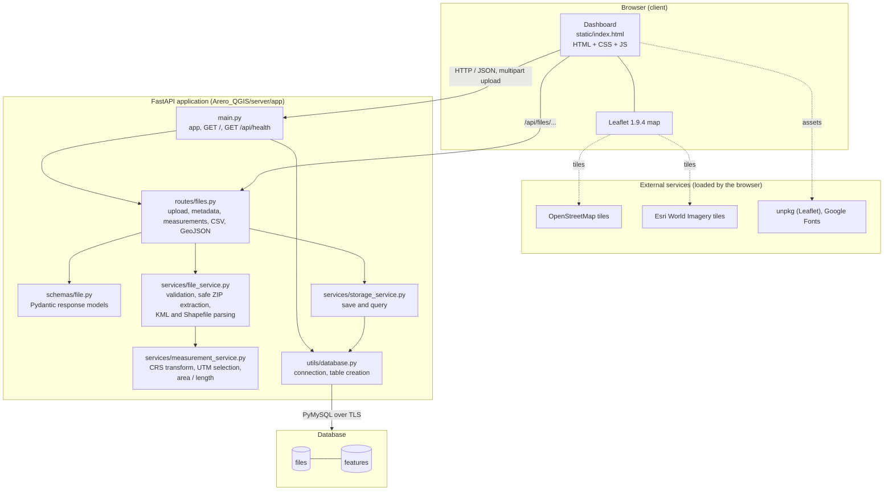
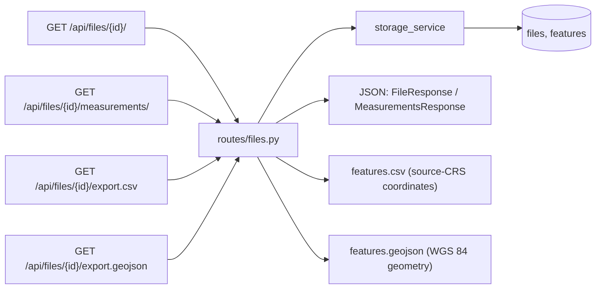
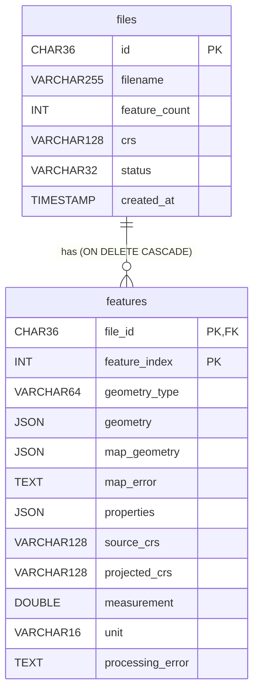

# GeoMeasure — A Geospatial File Measurement System


GeoMeasure is a web application for processing geographic datasets and reviewing per-feature measurements. A user uploads a **KML** file or a **ZIP archive containing one Shapefile**. The backend parses the geometries and attributes, transforms coordinates, calculates **area (m²)** for polygons and **length (m)** for lines, stores the results in a MySQL-compatible database, and serves them to a browser dashboard with an interactive map, a feature table, and CSV / GeoJSON exports.

The application lives in [`Arero_QGIS/`](Arero_QGIS/). The browser interface is served directly by FastAPI, so no separate frontend build step is required.

## Table of Contents

- [Overview](#overview)
- [Features](#features)
- [Technology Stack](#technology-stack)
- [Architecture and Processing Workflow](#architecture-and-processing-workflow)
- [Repository Structure](#repository-structure)
- [Prerequisites](#prerequisites)
- [Installation and Setup](#installation-and-setup)
- [Environment Variables](#environment-variables)
- [Database Schema](#database-schema)
- [API Reference and Swagger UI](#api-reference-and-swagger-ui)
- [Geospatial Measurement Methodology](#geospatial-measurement-methodology)
- [Usage Example](#usage-example)
- [Error Handling and Troubleshooting](#error-handling-and-troubleshooting)
- [Security and Operational Limitations](#security-and-operational-limitations)
- [Testing](#testing)
- [Future Improvements](#future-improvements)
- [License and Credits](#license-and-credits)

---

## Overview

Geographic datasets often contain many boundaries and routes. Measuring each polygon or line by hand is slow and can produce inconsistent results. GeoMeasure automates the process and lets users inspect the results next to the source features.

**Intended users:** GIS analysts, survey teams, planners, and developers who need quick, repeatable measurements from KML or Shapefile exchange data.

**Workflow:** upload a file → the API validates and parses it → each feature is transformed and measured → results are saved to the database → the dashboard shows the map, table, and totals → results can be exported as CSV or GeoJSON.

## Features

### Implemented

- Upload `.kml` files or `.zip` archives containing exactly one Shapefile (50 MiB upload limit).
- Extract feature geometries and attributes (KML Placemark `name`, `description`, and `ExtendedData`; Shapefile DBF attributes).
- Calculate **polygon / multipolygon area in square metres** and **line / multiline length in metres**.
- Read the Shapefile CRS from its `.prj` file; KML coordinates are treated as WGS 84 (EPSG:4326).
- Transform geometries to WGS 84 for map display and to a per-feature UTM zone for measurement.
- Interactive Leaflet map with street (OpenStreetMap) and satellite (Esri World Imagery) basemaps, light/dark theme, and "Fit all".
- Feature table with search, geometry-type filter, and sorting (index, name, geometry type, measurement).
- Selecting a feature in the table or on the map opens a detail panel (attributes, CRS info, errors, raw JSON with a copy button).
- Display-unit switching in the dashboard — area: m², hectares, km², acres, mi²; length: m, km, miles, feet.
- Persistence of dataset metadata and feature results in a MySQL-compatible database.
- Export of saved results to **CSV** and **GeoJSON**.
- Upload progress indicator with cancel, plus validation of extension, size, empty files, ZIP contents, and Shapefile components.
- Per-feature processing errors for null, empty, invalid, or unsupported geometries instead of failing the whole upload.

### Not implemented

Authentication, authorization, rate limiting, background jobs, automated tests, geodesic measurement, and geometry repair. See [Future Improvements](#future-improvements).

## Technology Stack

| Area | Technology | Responsibility |
| --- | --- | --- |
| Backend / API | Python, [FastAPI](https://fastapi.tiangolo.com/), Uvicorn (`uvicorn[standard]`) | REST endpoints, validation, OpenAPI/Swagger docs, serving the dashboard |
| Geometry | [Shapely](https://shapely.readthedocs.io/) (2.x API) | Geometry objects, validity checks, area/length |
| CRS | [pyproj](https://pyproj4.github.io/pyproj/) | CRS parsing and coordinate transformation |
| Shapefile | [pyshp](https://github.com/GeospatialPython/pyshp) (`shapefile`) | Reading `.shp` / `.dbf` data |
| Database | MySQL-compatible server via [PyMySQL](https://pymysql.readthedocs.io/) | Storing datasets and features |
| Configuration | python-dotenv, certifi | `.env` loading; CA bundle for TLS database connections |
| Uploads | python-multipart | Multipart form handling |
| Frontend | HTML, CSS, JavaScript, [Leaflet 1.9.4](https://leafletjs.com/) | Dashboard, map, table |
| Map tiles | OpenStreetMap, Esri World Imagery | Basemaps (loaded by the browser) |
| Fonts | Google Fonts (Geist) | UI typography (loaded by the browser) |
| Listed, unused by app code | `httpx`, `pytest` | In `requirements.txt`; no test files exist in the repository |

Python dependencies are listed in [`Arero_QGIS/server/requirements.txt`](Arero_QGIS/server/requirements.txt) (unpinned): `fastapi`, `uvicorn[standard]`, `python-multipart`, `shapely`, `pyproj`, `pyshp`, `httpx`, `pytest`, `python-dotenv`, `PyMySQL`, `certifi`.

## Architecture and Processing Workflow

GeoMeasure is a single-process, layered monolith: one FastAPI application serves the REST API and the static dashboard, and talks to one MySQL-compatible database. There is no separate frontend build, message queue, or background worker.

### System architecture



### Upload sequence

```mermaid
sequenceDiagram
    actor User
    participant UI as Browser dashboard
    participant R as routes/files.py
    participant F as file_service
    participant M as measurement_service
    participant S as storage_service
    participant DB as Database

    User->>UI: Choose .kml or .zip
    UI->>R: POST /api/files/ (multipart "file")
    R->>R: Check extension, read at most 50 MiB + 1 byte
    R->>F: process_uploaded_file(filename, content)
    F->>F: Write to temp dir; safe ZIP extraction if .zip
    F->>F: Parse KML (XML) or Shapefile (pyshp + .prj)
    F->>M: process_features(features, source_crs)
    M->>M: Transform to EPSG:4326, pick UTM zone, compute area / length
    M-->>F: CRS text + processed features (with per-feature errors)
    F-->>R: result (temp dir deleted)
    R->>S: save_processed_file(uuid, filename, crs, features)
    S->>DB: CREATE TABLE IF NOT EXISTS; INSERT files + features; COMMIT
    R-->>UI: 201 UploadResponse (id, features)
    UI-->>User: Map, feature table, totals, export buttons
```

### Retrieval and export flow



If the dataset ID does not exist, these routes return `404`; database failures return `503`.

### Component responsibilities

| Layer | File | Responsibility |
| --- | --- | --- |
| App entry | `app/main.py` | Creates the FastAPI app (title *Geospatial File Measurement API*, version `1.0.0`), serves the dashboard at `/`, defines `/api/health` |
| Routes | `app/routes/files.py` | Upload, retrieval and export endpoints; maps errors to HTTP status codes; builds CSV and GeoJSON |
| Schemas | `app/schemas/file.py` | Pydantic models: `FeatureResponse`, `UploadResponse`, `FileResponse`, `MeasurementsResponse`, `HealthResponse` |
| File service | `app/services/file_service.py` | Upload validation, safe ZIP extraction, KML and Shapefile parsing |
| Measurement service | `app/services/measurement_service.py` | WGS 84 transformation, UTM selection, area/length, per-feature errors |
| Storage service | `app/services/storage_service.py` | Parameterized inserts and selects for datasets and features |
| Database utility | `app/utils/database.py` | Environment-based TLS connection, lazy table creation, JSON decoding |
| Frontend | `app/static/index.html` | Single-page dashboard: upload, Leaflet map, feature table, units, exports |

### Design characteristics

- **Synchronous processing:** parsing, measuring and saving all happen inside the upload request.
- **Stateless server:** uploads are processed in a temporary directory and discarded; only results are persisted.
- **Lazy schema creation:** `files` and `features` are created on first database access.
- **Single deployable unit:** the API and UI ship together (see `server/vercel.json` for the Vercel function config).

## Repository Structure

```
.
├── README.md
└── Arero_QGIS/
    ├── README.md                      # Detailed application documentation
    ├── .gitignore                     # Ignores .env, .venv, caches, *.db, etc.
    └── server/
        ├── requirements.txt
        ├── vercel.json                # Vercel function config (app/main.py + static files)
        └── app/
            ├── main.py
            ├── routes/
            │   └── files.py
            ├── schemas/
            │   └── file.py
            ├── services/
            │   ├── file_service.py
            │   ├── measurement_service.py
            │   └── storage_service.py
            ├── static/
            │   └── index.html
            └── utils/
                └── database.py
```

There is no `tests/` directory, `LICENSE` file, or `.env.example` in the repository.

## Prerequisites

- **Python 3.10 or later.** The code uses `X | None` type annotations in Pydantic models, which require 3.10+ (the repository's existing documentation states the same).
- **pip** and the ability to create a virtual environment (`venv`).
- **A MySQL-compatible database** that accepts **TLS connections** (see [Environment Variables](#environment-variables) — the app always connects with TLS), a user that can connect and create tables in an existing database, and support for the `JSON` column type.
- **Internet access in the browser** for Leaflet (unpkg), map tiles (OpenStreetMap, Esri), and Google Fonts.

## Installation and Setup

### 1. Clone and enter the server directory

```bash
git clone https://github.com/chaithrikabeeraboyena17/Arero_GFMA.git
cd Arero_GFMA/Arero_QGIS/server
```

### 2. Create and activate a virtual environment

**Windows PowerShell**

```powershell
python -m venv .venv
.\.venv\Scripts\Activate.ps1
```

**Linux / macOS**

```bash
python3 -m venv .venv
source .venv/bin/activate
```

### 3. Install dependencies

```bash
python -m pip install -r requirements.txt
```

### 4. Configure environment variables

Create `Arero_QGIS/server/.env` (see [Environment Variables](#environment-variables)). Never commit this file.

### 5. Prepare the database

Create an empty database and make sure the application user can read, write, and **create tables** in it. Example for a generic MySQL-compatible server (adapt names and host restrictions to your environment):

```sql
CREATE DATABASE geomeasure CHARACTER SET utf8mb4 COLLATE utf8mb4_unicode_ci;
CREATE USER 'geomeasure_app'@'%' IDENTIFIED BY 'choose-a-strong-password';
GRANT SELECT, INSERT, CREATE ON geomeasure.* TO 'geomeasure_app'@'%';
```

The tables `files` and `features` are created **automatically with `CREATE TABLE IF NOT EXISTS`** the first time the application runs a database operation — `GET /api/health`, an upload, or any retrieval/export call. You do not need to create them manually, but the user needs `CREATE` privilege until they exist.

> **Note:** The connection code always enables TLS and verifies the server certificate against the `certifi` CA bundle. A local MySQL server without TLS, or one with a self-signed certificate, will fail to connect unless the code is changed. Managed services with publicly trusted certificates (the code's error messages reference TiDB Cloud) work as written.

### 6. Start the application

```bash
python -m uvicorn app.main:app --reload
```

### 7. Open the application

| Resource | Local URL |
| --- | --- |
| Dashboard | <http://127.0.0.1:8000/> |
| Swagger UI | <http://127.0.0.1:8000/docs> |
| ReDoc | <http://127.0.0.1:8000/redoc> |
| OpenAPI JSON | <http://127.0.0.1:8000/openapi.json> |
| Health check | <http://127.0.0.1:8000/api/health> |

These are **local development URLs**, not public deployment URLs. Open the health check first: `{"status":"ok"}` confirms the database is reachable and the tables exist.

### Vercel

[`server/vercel.json`](Arero_QGIS/server/vercel.json) registers `app/main.py` as a function and includes `app/static/**`. If deploying to Vercel, set the project root to `Arero_QGIS/server` and define the database variables in the deployment environment. No other deployment automation exists in the repository, and a Vercel deployment has not been verified here.

## Environment Variables

The database module loads `Arero_QGIS/server/.env` via `python-dotenv` when it is imported. Template (`.env.example`-style, placeholders only):

```dotenv
DB_HOST=your_database_host
DB_PORT=4000
DB_USERNAME=your_database_username
DB_PASSWORD=your_database_password
DB_DATABASE=your_existing_database_name
```

| Variable | Required | Description |
| --- | :---: | --- |
| `DB_HOST` | Yes | Database hostname |
| `DB_USERNAME` | Yes | Database user |
| `DB_PASSWORD` | Yes | Database password |
| `DB_DATABASE` | Yes | Name of an **existing** database |
| `DB_PORT` | No | Defaults to `4000`; must be an integer from 1 to 65535 |

Connection behaviour (from `app/utils/database.py`): `utf8mb4` charset, 10-second connect timeout, TLS always enabled with the `certifi` CA bundle. The default port `4000` is the TiDB convention; standard MySQL uses `3306`, so set `DB_PORT` explicitly for MySQL. `.env` and `.env.*` are git-ignored (except `.env.example`) — never commit real credentials.

## Database Schema

Created automatically by `initialize_database()`; both tables use `utf8mb4` / `utf8mb4_unicode_ci`.

### `files` — one row per uploaded dataset

| Column | Type | Constraints |
| --- | --- | --- |
| `id` | `CHAR(36)` | Primary key (UUID generated by the API) |
| `filename` | `VARCHAR(255)` | Not null |
| `feature_count` | `INT` | Not null |
| `crs` | `VARCHAR(128)` | Nullable (null when a Shapefile has no `.prj`) |
| `status` | `VARCHAR(32)` | Not null (`COMPLETED` on successful save) |
| `created_at` | `TIMESTAMP` | Not null, default `CURRENT_TIMESTAMP` |

### `features` — one row per feature

| Column | Type | Constraints / meaning |
| --- | --- | --- |
| `file_id` | `CHAR(36)` | Not null; part of primary key; FK → `files(id)` `ON DELETE CASCADE` |
| `feature_index` | `INT` | Not null; part of primary key (0-based order in the source) |
| `geometry_type` | `VARCHAR(64)` | Nullable (e.g. `Polygon`) |
| `geometry` | `JSON` | Source-CRS geometry as GeoJSON-style mapping |
| `map_geometry` | `JSON` | WGS 84 geometry for display/export; null if unavailable |
| `map_error` | `TEXT` | Error from the WGS 84 transformation, if any |
| `properties` | `JSON` | Not null; feature attributes |
| `source_crs` | `VARCHAR(128)` | Source CRS string |
| `projected_crs` | `VARCHAR(128)` | UTM CRS used for measurement |
| `measurement` | `DOUBLE` | Area (m²) or length (m); null for points / errors |
| `unit` | `VARCHAR(16)` | `m²` or `m` |
| `processing_error` | `TEXT` | Reason a feature could not be measured |

Primary key: `(file_id, feature_index)`.



## API Reference and Swagger UI

FastAPI generates interactive documentation from the routes. With the server running locally:

- **Swagger UI:** <http://127.0.0.1:8000/docs>
- **ReDoc:** <http://127.0.0.1:8000/redoc>
- **OpenAPI JSON:** <http://127.0.0.1:8000/openapi.json>

The API title is *Geospatial File Measurement API*, version `1.0.0`. The `/` dashboard route is excluded from the OpenAPI schema. These URLs are local only.

### Endpoints

| Method | Path | Purpose | Success | Errors |
| --- | --- | --- | --- | --- |
| `GET` | `/api/health` | Check DB connectivity and initialize tables | `200` `{"status": "ok"}` | `503` database unavailable or misconfigured |
| `POST` | `/api/files/` | Upload and process a `.kml` or `.zip` file | `201` `UploadResponse` | `400` bad extension / too large / empty / invalid content; `422` missing `file` field; `503` database error |
| `GET` | `/api/files/{file_id}/` | Dataset metadata | `200` `FileResponse` | `404` not found; `503` database error |
| `GET` | `/api/files/{file_id}/measurements/` | All saved features | `200` `MeasurementsResponse` | `404` not found; `503` database error |
| `GET` | `/api/files/{file_id}/export.csv` | CSV download (`features.csv`) | `200` `text/csv` | `404`; `503` |
| `GET` | `/api/files/{file_id}/export.geojson` | GeoJSON download (`features.geojson`) | `200` `application/geo+json` | `404`; `503` |

These six routes are the complete set of registered application routes (plus the unlisted `/` dashboard and FastAPI's built-in docs routes).

### Request format — `POST /api/files/`

`multipart/form-data` with one required field, **`file`**: a `.kml` file or a `.zip` archive containing one Shapefile (`.shp`, `.shx`, `.dbf`, ideally `.prj`). Maximum size 50 MiB.

### Response schemas

**`FeatureResponse`**

| Field | Type |
| --- | --- |
| `index` | integer |
| `geometry_type` | string \| null |
| `geometry` | object \| null (source CRS) |
| `map_geometry` | object \| null (WGS 84) |
| `map_error` | string \| null |
| `properties` | object |
| `source_crs` | string \| null |
| `projected_crs` | string \| null |
| `measurement` | number \| null |
| `unit` | string \| null |
| `processing_error` | string \| null |

**`UploadResponse`**: `id`, `filename`, `feature_count`, `crs`, `status`, `features[]` (`FeatureResponse`).
**`FileResponse`**: `id`, `filename`, `feature_count`, `crs`, `status`.
**`MeasurementsResponse`**: `file_id`, `features[]`.
**`HealthResponse`**: `status`.

Illustrative upload response for a KML polygon (structure from the schemas; values are placeholders, not real output):

```json
{
  "id": "<FILE_ID>",
  "filename": "survey.kml",
  "feature_count": 1,
  "crs": "EPSG:4326",
  "status": "COMPLETED",
  "features": [
    {
      "index": 0,
      "geometry_type": "Polygon",
      "geometry": { "type": "Polygon", "coordinates": ["..."] },
      "map_geometry": { "type": "Polygon", "coordinates": ["..."] },
      "map_error": null,
      "properties": { "Name": "Plot A" },
      "source_crs": "EPSG:4326",
      "projected_crs": "EPSG:326xx",
      "measurement": 0.0,
      "unit": "m²",
      "processing_error": null
    }
  ]
}
```

Error bodies use FastAPI's standard shape, e.g. `{"detail": "File not found"}`.

### Using Swagger UI to upload

1. Start the server and open <http://127.0.0.1:8000/docs>.
2. Expand **`POST /api/files/`** and click **Try it out**.
3. Under `file`, click **Choose File** and select a `.kml` file or a zipped Shapefile.
4. Click **Execute**. A `201` response contains the dataset `id` and every processed feature.
5. Copy the `id` and use it in the `GET` endpoints (**Try it out** → paste into `file_id` → **Execute**).

### `curl` examples

Replace `<FILE_ID>` with the `id` returned by the upload.

```bash
# Health check
curl http://127.0.0.1:8000/api/health

# Upload a KML file or zipped Shapefile
curl -X POST http://127.0.0.1:8000/api/files/ -F "file=@survey.kml"
curl -X POST http://127.0.0.1:8000/api/files/ -F "file=@boundaries.zip"

# Dataset metadata and measurements
curl http://127.0.0.1:8000/api/files/<FILE_ID>/
curl http://127.0.0.1:8000/api/files/<FILE_ID>/measurements/

# Exports
curl -o features.csv     http://127.0.0.1:8000/api/files/<FILE_ID>/export.csv
curl -o features.geojson http://127.0.0.1:8000/api/files/<FILE_ID>/export.geojson
```

These commands are derived from the route definitions; they have not been executed against a live database as part of writing this document.

### Export formats

**CSV** columns: `feature_id`, `feature_index`, `geometry_type`, `coordinates`, `crs`, `source_crs`, `projected_crs`, `properties`, `measurement`, `measurement_unit`. `feature_id` is `<file_id>:<feature_index>`; `coordinates` are in the **source** CRS.

**GeoJSON**: a `FeatureCollection` whose geometries are the WGS 84 `map_geometry`. Each feature's `properties` hold `feature_id`, `feature_index`, `geometry_type`, `crs` (`EPSG:4326`), `source_crs`, `projected_crs`, the original `properties`, `measurement`, and `measurement_unit`. If a feature has no map geometry but has a source geometry, it is included as `source_geometry` in the properties.

## Geospatial Measurement Methodology

**Supported geometry types:** Point, MultiPoint, LineString, MultiLineString, Polygon, MultiPolygon.

| Geometry | Mapped | Measured |
| --- | :---: | --- |
| Polygon, MultiPolygon | Yes | Area in m² |
| LineString, MultiLineString | Yes | Length in m |
| Point, MultiPoint | Yes | Not measured (no area or length, no error) |
| Other (e.g. `GeometryCollection`) | If CRS known | No — `processing_error: Unsupported geometry type: …` |

**Source CRS**
- **KML:** coordinates are assumed to be WGS 84 (EPSG:4326).
- **Shapefile:** read from the matching `.prj` (WKT). If no `.prj` exists, the CRS is unknown: features are stored, but no map geometry is produced and measurable features get the error `Cannot measure feature because its CRS is missing`. An unreadable `.prj` rejects the upload.

**Map display:** each geometry is transformed to EPSG:4326 (`always_xy=True`) and stored as `map_geometry`. A failed transformation is recorded in `map_error`.

**Projected CRS for measurement:** for each measurable feature, a representative point is taken in WGS 84 and the matching UTM zone is chosen — `EPSG:326xx` (north) or `EPSG:327xx` (south), zone = `floor((lon + 180) / 6) + 1`, capped at 60. Area or length is then computed in that planar CRS. Features whose representative point is outside longitude −180…180 or latitude −80…84 get a `Could not measure feature` error.

**Units:** area in square metres (`m²`), length in metres (`m`). The dashboard can convert for display.

**Special cases**
- Null geometry → `Feature has null geometry`.
- Empty geometry → `Feature has empty geometry`.
- Invalid geometry (per Shapely) → `Feature geometry is invalid`; the geometry is **not** repaired.
- Individual feature errors do not fail the upload.

**KML parsing notes:** `Placemark` elements containing `Point`, `LineString`, `Polygon`, or `MultiGeometry` are read. A `MultiGeometry` of one geometry type becomes a Multi* geometry; mixed types become a `GeometryCollection` (unsupported for measurement). Rings with fewer than four coordinates are skipped. Files with no usable features are rejected.

**Accuracy limitations:** measurements are planar in a single UTM zone chosen per feature. They are suitable for many regional datasets but become less accurate for features that span large distances, cross UTM zones, or lie near/outside the UTM latitude range. No geodesic or equal-area calculation is performed. Measurements are only as reliable as the source CRS information.

## Usage Example

1. **Prepare data:** a valid `.kml`, or a `.zip` containing one Shapefile with `.shp`, `.shx`, `.dbf`, and preferably `.prj`.
2. **Start the server:** configure `.env`, activate the virtual environment, and run `python -m uvicorn app.main:app --reload` from `Arero_QGIS/server`.
3. **Verify the database:** open <http://127.0.0.1:8000/api/health> and expect `{"status":"ok"}`.
4. **Upload:** open <http://127.0.0.1:8000/>, choose or drop the file, and click **Process file** (or use Swagger UI / `curl`).
5. **Inspect the result:** note the dataset `id` and `feature_count` (returned by the API; the dashboard shows the file name and feature count).
6. **Explore:** use the map and feature table — search, filter by geometry type, sort, switch units and basemap, and select features to see attributes, CRS details, and any processing errors.
7. **Export:** use the **CSV** or **GeoJSON** buttons, or the export endpoints with the dataset ID.

## Error Handling and Troubleshooting

| Problem | Typical response | Cause and solution |
| --- | --- | --- |
| Unsupported extension | `400` "Unsupported file extension. Upload a .kml or .zip file" | Only `.kml` and `.zip` are accepted |
| File too large | `400` "Uploaded file exceeds the 50 MB size limit" | Limit is 50 MiB; reduce or split the dataset |
| Empty file | `400` "Uploaded file is empty" | Re-export the source file |
| Missing `file` field | `422` | Send multipart form data with the field name `file` |
| Corrupt ZIP / unsafe archive | `400` | Messages include corrupt ZIP, too many files (> 2000), expanded size > 200 MiB, unsafe path, symbolic link, duplicate paths. Re-create the archive with plain files only |
| No or multiple Shapefiles | `400` "ZIP archive does not contain a Shapefile (.shp)" / "…multiple Shapefiles; expected one" | Include exactly one Shapefile per ZIP |
| Incomplete Shapefile | `400` "Shapefile is missing required component(s): …" | Include `.shp`, `.shx`, and `.dbf` with matching base names |
| Invalid KML | `400` "Could not parse KML XML…" / "KML document has an invalid root element" | Validate the KML; the root element must be `kml` |
| No features | `400` "Uploaded geospatial file contains no features" | Ensure the file has Placemarks/records with geometry |
| Missing CRS | Feature `processing_error`: "Cannot measure feature because its CRS is missing" | Add a `.prj` file to the Shapefile archive |
| Dataset ID not found | `404` "File not found" | Check the ID returned by the upload |
| Missing environment variables | `503` "Database unavailable." on `/api/health` | Set `DB_HOST`, `DB_USERNAME`, `DB_PASSWORD`, `DB_DATABASE` in `server/.env` |
| Database does not exist (MySQL error 1049) | `503` "The configured database does not exist…" | Create it or point `DB_DATABASE` at an existing database |
| Insufficient privileges (MySQL error 1142) | `503` "The database user cannot create tables in this schema…" | Grant `CREATE` (plus `SELECT`, `INSERT`) on the database |
| Other database failure | `503` "Could not … in the database. Check the database configuration…" | Check host, port, credentials, network access, and that the server accepts TLS |

## Security and Operational Limitations

**Implemented**
- Upload size limit (50 MiB) and extension / empty-content checks.
- ZIP hardening: member-count limit (2000), expanded-size limit (200 MiB), rejection of absolute paths, `..` segments, drive letters, symbolic links, and duplicate entries; extraction into a temporary directory that is deleted afterwards.
- Parameterized SQL statements; transaction rollback on failed saves.
- TLS database connections using the `certifi` CA bundle.
- `.env` files excluded from Git.

**Not implemented**
- Authentication and authorization — all stored datasets are readable by anyone who knows (or obtains) a dataset ID; there is no per-user separation.
- Rate limiting, quotas, malware scanning.
- Background jobs — processing happens synchronously inside the upload request, with no server-side progress reporting.
- Automated tests and a documented production deployment process.

Do not expose this application publicly with sensitive datasets without adding the missing controls.

## Testing

`pytest` and `httpx` are listed in `requirements.txt`, but **the repository contains no automated tests**, so there is no test suite or coverage to report. After tests are added, they can be run from `Arero_QGIS/server` with:

```bash
python -m pytest
```

For a manual smoke test, start the server and use the health check and upload `curl` commands shown in the [API section](#curl-examples).

## Future Improvements

These are **not implemented**:

- Automated tests for KML/Shapefile parsing, CRS handling, database operations, and API responses.
- Geodesic or equal-area measurement for features that are large or cross UTM zones.
- Background processing and pagination for large datasets.
- Authentication, authorization, rate limiting, and per-user data separation.
- Additional upload formats (e.g. GeoJSON, GeoPackage) and broader KML support.
- Pinned dependency versions, an `.env.example` file, and documented deployment/release steps.
- Optional non-TLS database configuration for local development.

## License and Credits

- **License:** no `LICENSE` file is present in the repository, so no license is specified. Add one before redistributing or accepting external contributions.
- **Repository owner:** [chaithrikabeeraboyena17](https://github.com/chaithrikabeeraboyena17).
- **Libraries:** FastAPI, Uvicorn, Shapely, pyproj, pyshp, PyMySQL, python-dotenv, python-multipart, certifi, Leaflet.
- **Map data and tiles:** © [OpenStreetMap](https://www.openstreetmap.org/copyright) contributors; Esri World Imagery.